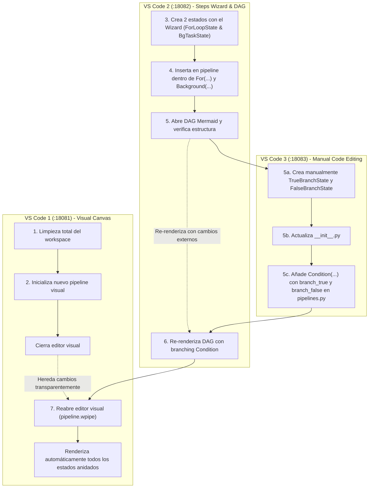

# Procedimiento de Pruebas de WPipe Studio (VS Code Extension & Tri-Instance Docker)

Este documento detalla el procedimiento estandarizado para probar de forma integral y repetible la extensión `wpipe-vscode` en vivo, sin necesidad de consultar nuevamente las directivas.

---

## 1. Topología del Entorno de Pruebas

El entorno de pruebas de la extensión de VS Code se apoya en 3 instancias simultáneas de `code-server` corriendo en contenedores Docker y mapeadas contra el workspace del microservicio generado (`/home/wisrovi/Downloads/ksñldfg/app` montado en `/home/coder/workspace`):

| Instancia | Puerto Local | Contenedor Docker | Rol en Pruebas |
|---|---|---|---|
| **Página 1 (Instancia 1)** | `http://localhost:18081/?folder=/home/coder/workspace` | `ksldfg-code-server-1` | **Canvas Visual Blockly (`pipeline.wpipe`)**: Comprobación del layout de bloques, conexiones en serie/paralelo, badges de licencia (`Blocks X / ∞ · PRO`), paleta de herramientas y consola sin errores de CSP. |
| **Página 2 (Instancia 2)** | `http://localhost:18082/?folder=/home/coder/workspace` | `ksldfg-code-server2-1` | **Explorador y Árbol de Estados (`app/states/`)**: Inspección del registro de estados, archivos `.py` sincronizados, creación vía Wizard y árbol lateral de pasos. |
| **Página 3 (Instancia 3)** | `http://localhost:18083/?folder=/home/coder/workspace` | `ksldfg-code-server3-1` | **Editor de Código Python (`app/pipelines.py`)**: Validación del código descompilado/compilado, ejecución con `execute_pipeline(payload)`, decoradores `@step` y `@to_obj`. |

---

## 2. Ciclo Completo de Compilación y Despliegue en Caliente

Antes de verificar en los navegadores, siempre que se modifique código en `vscode-extension/`:

### Paso 2.1: Compilar TypeScript
```bash
npm --prefix vscode-extension/extension run compile
```

### Paso 2.2: Empaquetar el VSIX
```bash
cd vscode-extension/extension
vsce package --no-git-tag-version --allow-missing-repository -o wpipe-vscode-2.0.0.vsix
cd ../..
```

### Paso 2.3: Desplegar forzadamente en las 3 instancias de Docker
```bash
VSIX="vscode-extension/extension/wpipe-vscode-2.0.0.vsix"
for C in ksldfg-code-server-1 ksldfg-code-server2-1 ksldfg-code-server3-1; do
    docker cp "$VSIX" "$C":/tmp/
    docker exec "$C" code-server --install-extension /tmp/wpipe-vscode-2.0.0.vsix --force
done
```

---

## 3. Protocolo de Pruebas con Chrome MCP (`chrome-devtools`)

Para interactuar y auditar las 3 páginas web con las tools lazy de MCP:

### 3.1 Listar las Páginas Activas
```json
call_mcp_tool:
  ServerName: "chrome-devtools"
  ToolName: "list_pages"
  Arguments: {}
```
Verifica que las páginas 1, 2 y 3 corresponden a los puertos 18081, 18082 y 18083.

### 3.2 Seleccionar y Recargar Páginas
Para forzar que el cliente Webview cargue el nuevo VSIX:
```json
call_mcp_tool:
  ServerName: "chrome-devtools"
  ToolName: "evaluate_script"
  Arguments:
    pageId: 1
    function: "() => window.location.reload()"
```
*(Repetir con `pageId: 2` y `pageId: 3`)*

### 3.3 Auditoría de Consola (Cero Violaciones CSP)
```json
call_mcp_tool:
  ServerName: "chrome-devtools"
  ToolName: "list_console_messages"
  Arguments:
    pageId: 1
```
**Criterio de Aceptación:**
- Cero errores bloqueantes de Content Security Policy (`font-src`, `connect-src`, `script-src`).
- Cero excepciones de scripts no capturados o cargas de recursos 404.

### 3.4 Captura de Pantalla para Evidencia Visual
```json
call_mcp_tool:
  ServerName: "chrome-devtools"
  ToolName: "take_screenshot"
  Arguments:
    pageId: 1
```
**Qué inspeccionar visualmente en la imagen generada:**
1. Los bloques de Blockly se renderizan nítidamente con sus conexiones encadenadas (`CleanDataStep` $\rightarrow$ `TransformPayloadStep` $\rightarrow$ `AISentimentStep` $\rightarrow$ ...).
2. El trigger `wpipe_trigger` y la respuesta `wpipe_response` están correctamente anclados en los extremos.
3. El footer del Canvas muestra el contador dinámico exacto de bloques (p. ej. `Blocks 7 / ∞ · PRO`).

---

## 4. Sincronización Bidireccional: Cómo y Qué Probar

El valor diferencial de WPipe Studio es que la edición de código sincroniza el canvas, y la edición del canvas sincroniza el código.

### 4.1 Prueba Código $\rightarrow$ Canvas
1. En `/home/wisrovi/Downloads/ksñldfg/app/app/pipelines.py`, añade un nuevo estado a la lista de `set_steps([...])` (por ejemplo `QualityCheckStep()`).
2. Actualiza la marca de tiempo del archivo para notificar al inotify watcher dentro de los contenedores Docker:
   ```bash
   touch /home/wisrovi/Downloads/ksñldfg/app/app/pipelines.py
   ```
3. Toma una captura con `take_screenshot` en la Página 1 (`:18081`).
4. **Verificación:** El nuevo bloque debe aparecer automáticamente en el Canvas visual sin requerir recargar la página.

### 4.2 Prueba Wizard $\rightarrow$ Workspace $\rightarrow$ Editor
1. Ejecuta el wizard o genera un estado personalizado en `app/states/<nuevo_estado>.py`.
2. Verifica que el archivo respete el Dialecto A:
   - Decorador `@step(name="...", version="1.0.0")`
   - `@to_obj(ContextDTO)` y `@timeout_sync(seconds=...)`
   - Método `__call__(self, context: Any) -> Any`
3. En la Página 2 (`:18082`), comprueba que aparezca en el árbol de pasos.
4. En la Página 3 (`:18083`), comprueba que el editor refleje el código Python sin advertencias de diagnóstico.

---

## 6. Procedimiento Canónico E2E Multi-VSCode (Flujo Transparente Tri-Instancia)

Este escenario valida la colaboración distribuida, descompilación balanceada AST y sincronización transparente entre 3 instancias de VS Code Web conectadas al mismo workspace:



### Pasos Operativos del Escenario E2E

1. **VS Code 1 (`:18081`)**:
   - Inicia desde un workspace completamente limpio (archivos eliminados).
   - Genera/abre el canvas visual de bloques (`pipeline.wpipe`) iniciando un nuevo pipeline vacío (`MainPipeline`).
   - Cierra el canvas antes de pasar a la siguiente instancia.

2. **VS Code 2 (`:18082`)**:
   - Ejecuta el Wizard de creación de estados (`wpipe-vscode.createNewStep`) creando 2 estados: `ForLoopState` y `BgTaskState`.
   - Incluye ambos estados en `app/pipelines.py`: uno dentro de un bucle `For(iterations=3, steps=[ForLoopState()])` y el otro en una tarea asíncrona en segundo plano `Background(step=BgTaskState())`.
   - Abre la vista previa del DAG (`wpipe-vscode.previewDAG`) y confirma que captura el pipeline completo con el bucle y la tarea asíncrona.

3. **VS Code 3 (`:18083`)**:
   - De forma manual (creando los archivos en `app/states/` y editando `app/states/__init__.py`), crea 2 estados adicionales: `TrueBranchState` y `FalseBranchState`.
   - Modifica `app/pipelines.py` agregando una estructura condicional `Condition(expression="status_code == 200", branch_true=[TrueBranchState()], branch_false=[FalseBranchState()])`.

4. **VS Code 2 (`:18082`)**:
   - Vuelve a renderizar el DAG interactivo (`previewDAG`).
   - Confirma visualmente que el grafo Mermaid se actualiza mostrando las ramas condicionales `True` y `False` con los nuevos estados creados en VS Code 3.

5. **VS Code 1 (`:18081`)**:
   - Reabre el diagrama de bloques visual (`pipeline.wpipe`).
   - El descompilador de AST balanceado procesa directamente el código modificado por las otras instancias, renderizando de forma directa y transparente todos los bloques: el bucle `For`, la tarea `Background`, y la bifurcación `Condition` con sus ramas sin pérdida de información.


---

## 7. Batería de Pruebas Automatizadas de Calidad (Obligatorias)

Ningún cambio se considera terminado si no pasan todas las siguientes suites:

### 7.1 Daemon OS Suite (51 Pruebas)
```bash
pytest vscode-extension/daemon_os/tests/ -v
```

### 7.2 Admin Cloudfire Suite (12 Pruebas)
```bash
PYTHONPATH=/home/wisrovi/Documents/w_libraries/wpipe_os/wpipe/editors/extension_example/.venv/lib/python3.12/site-packages:vscode-extension/admin-cloudfire pytest vscode-extension/admin-cloudfire/tests/ -v
```
