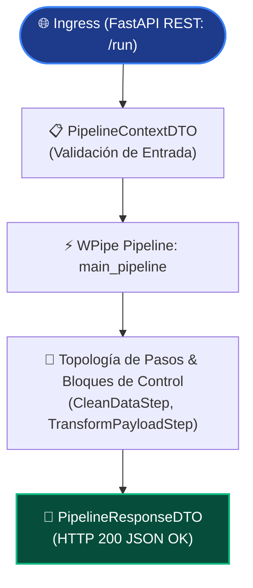

# main_pipeline

> **Enterprise Python Microservice Orchestration**  
> Auto-generado, compilado y verificado por **WPipe Studio (wisrovi SUITE)**.

---

## ⚖️ Legal Notice, Authorship & Intellectual Property Rights

> [!IMPORTANT]
> **Aviso Prioritario de Derechos de Autor y Protección de Código**  
> Este documento establece con carácter vinculante y oficial los **derechos de autor, propiedad intelectual y atribución técnica** del presente microservicio. Este archivo se encuentra protegido contra edición manual en WPipe Studio.

### Plataforma & Ecosistema de Ingeniería
- **Suite de Orquestación**: [WPipe Studio](https://github.com/wisrovi/wpipe-studio) (wisrovi SUITE) — Plataforma visual de ingeniería de microservicios y diseño modular de pipelines.
- **Motor Core**: [WPipe](https://github.com/wisrovi/wpipe) (wisrovi SUITE) >=2.5.13.
- **Fecha de Compilación**: `2026-10-27 12:13:13 UTC`.
- **Estándar de Generación**: Dialecto A (Contratos Pydantic Context DTOs + AST Jerárquico Topológico + wpipe-mcp).

### Autor & Atribución Profesional
- **Autor Principal**: **William Rodriguez** ([wisrovi](https://wisrovi.dev))
- **Perfil Profesional**: **AI Leader & Solutions Architect**
- **Sitio Web Oficial**: [https://wisrovi.dev](https://wisrovi.dev)
- **Ubicación**: Badajoz, Extremadura, España
- **Misión & Especialidad**: *Liderazgo en inteligencia artificial avanzada, arquitecturas cloud distribuidas y diseño de motores de orquestación de alto rendimiento.*
- **Copyright**: © 2026 **wisrovi** ([wisrovi.dev](https://wisrovi.dev)). Todos los derechos reservados / All Rights Reserved.

### Términos de Derechos y Uso
Este componente de software y su topología de ejecución fueron diseñados y compilados bajo la infraestructura de **WPipe Studio**. Todos los patrones arquitectónicos, abstracciones de DTOs tipados, vinculaciones de estados (`@step`) y contratos de orquestación forman parte de la propiedad intelectual exclusiva de **wisrovi** ([wisrovi.dev](https://wisrovi.dev)). Queda prohibida la alteración no autorizada de metadatos de autoría y derechos protegidos.

---

## 📖 Documentación Técnica del Microservicio

### Descripción General
El microservicio `main_pipeline` expone un flujo de trabajo modular asíncrono y de alto rendimiento, orquestado mediante **WPipe** y servido a través de **FastAPI**.

- **Pipeline Core**: `main_pipeline` (`app/pipelines.py`)
- **Topología de Pasos Ensamblados**: CleanDataStep, TransformPayloadStep.
- **Bloques de Control Soportados**: Bifurcaciones condicionales (`Condition`), bucles deterministas o continuos (`For`), ejecución concurrente (`Parallel`) y tareas desacopladas (`Background`).
- **Contratos de Datos**: Clases Pydantic en `app/dto/` con validación estricta de tipos, inmutabilidad y serialización de contexto vía `@to_obj`.

### Diagrama de Flujo (Mermaid DAG)



### Estructura de Directorios (wpipe-mcp Architecture)

```
main_pipeline/
├── app/
│   ├── config/              # Configuración y variables de entorno
│   │   ├── config.yaml      # Parámetros YAML de microservicio
│   │   └── settings.py      # Pydantic AppSettings tipado
│   ├── dto/                 # Contratos Pydantic Context DTOs (Dialecto A)
│   │   ├── context.py       # PipelineContextDTO
│   │   ├── request.py       # PipelineRequestDTO
│   │   └── response.py      # PipelineResponseDTO
│   ├── model/               # Model weights & pre-trained artifacts
│   │   └── .gitkeep
│   ├── services/            # Servicios desacoplados de dominio pesado
│   │   └── business_service.py # ProcessingService
│   ├── states/              # Clases atómicas de estados WPipe (@step)
│   │   ├── base.py          # BaseStep clase abstracta
│   │   ├── clean_data_step.py # CleanDataStep
│   │   ├── transform_payload_step.py # TransformPayloadStep
│   │   └── ai_sentiment_step.py # AISentimentStep
│   ├── test/                # Suite oficial pytest del microservicio
│   │   ├── test_dto.py      # Validación de esquemas Pydantic
│   │   ├── test_states.py   # Mutaciones y ciclo de vida de steps
│   │   ├── test_pipeline.py # Validación del grafo de pipeline
│   │   └── test_api.py      # Integración con TestClient FastAPI
│   ├── utils/               # Funciones auxiliares puras
│   │   └── helpers.py       # Generadores de ID y sanitizadores
│   ├── pipelines.py         # Topología DAG del pipeline WPipe con C-blocks
│   └── main.py              # Entrypoint FastAPI REST y ResourceMonitor
├── tests/                   # Runner estándar raíz
│   └── test_pipeline.py
├── pytest.ini               # Configuración de runner pytest y pythonpath
├── pyproject.toml           # Configuración estándar para Black, isort y mypy
├── Dockerfile               # Contenedor de producción multi-etapa
├── docker-compose.yml       # Orquestación Docker con healthcheck HTTP
├── Makefile                 # Automatización (start, stop, into, test, logs)
├── requirements.txt         # Dependencias Python bloqueadas
├── run_tests_docker.sh      # Script ejecutor que delega en 'make test'
└── wpipe.config.json        # Configuración del motor WPipe
```

### Tecnologías y Librerías Principales

- **[WPipe](https://github.com/wisrovi/wpipe) (>=2.5.13)**: Motor core de ejecución orquestada de pipelines síncronos y asíncronos con gestión de contexto y control de flujo.
- **[WPipe Steps](https://github.com/wisrovi/wpipe-steps) (>=1.0.2)**: Catálogo modular de pasos para bases de datos, conectividad y seguridad.
- **[FastAPI](https://fastapi.tiangolo.com/) & Uvicorn**: API HTTP REST asíncrona de alto rendimiento para el punto de entrada (`/run`).
- **[Pydantic v2](https://docs.pydantic.dev/)**: Validación estricta de contratos de datos e inmutabilidad de contexto.
- **[Loguru](https://github.com/Delgan/loguru)**: Registro estructurado y asíncrono de eventos de ejecución.
- **[Pytest & Pytest-Cov](https://pytest.org/)**: Suite de pruebas unitarias automatizadas con cobertura de código.
- **[Docker & Docker Compose](https://www.docker.com/)**: Contenedorización lista para producción.

---

## 🚀 Despliegue y Ejecución

### 1. Iniciar con Docker Compose (Recomendado)
```bash
# Construir y levantar el microservicio
make start

# Ver el estado y healthcheck:
make status

# Ver logs en tiempo real:
make logs

# Entrar en consola interactiva al contenedor:
make into

# Detener el microservicio:
make stop
```

### 2. Ejecución Local con Virtualenv
```bash
python -m venv .venv
source .venv/bin/activate
pip install -r requirements.txt
python app/main.py
```

### 3. Endpoints y Documentación Interactiva
- **Ejecutar Pipeline**: `POST /run` (Envío de payload JSON para procesar en el pipeline)
- **Comprobación de Salud**: `GET /health`
- **Documentación Swagger UI**: `http://localhost:8000/docs`
- **Especificación OpenAPI**: `http://localhost:8000/openapi.json`

### 4. Pruebas Automatizadas
```bash
# Ejecutar pruebas en Docker vía Makefile:
./run_tests_docker.sh

# O directamente:
make test

# Ejecución local con reporte de cobertura:
make pytest
```

---
*Generated by WPipe Studio by wisrovi*
